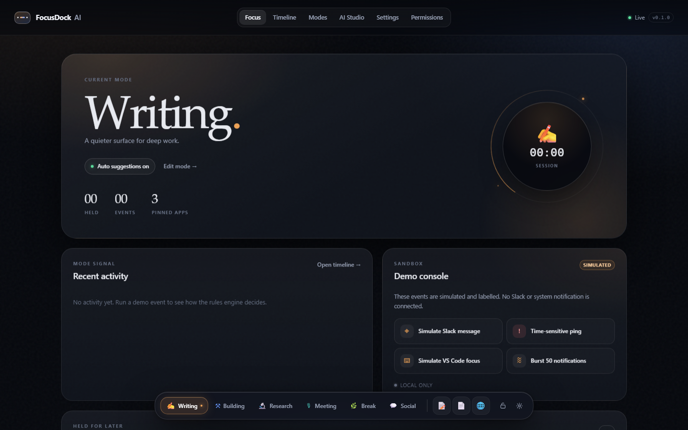

# FocusDock AI

**A local-first, AI-native focus dock with customizable modes and an optional macOS companion.**

English · [简体中文](README.zh-CN.md)



FocusDock AI is a real, runnable local web app: a bottom capsule dock, editable
modes, a deterministic rules engine that works offline, a reviewable AI mode
editor, a notification queue with a 30-second switch cool-down, and an audit
timeline. Everything is stored in a local SQLite file; no account, no telemetry,
no cloud key required.

> **This is not a system-notification blocker and not a replacement for the
> macOS Dock.** Public Apple APIs do not allow one app to intercept another
> app's notifications. The UI says so, and every simulated event is labelled.

## Status (v0.1.0)

| Area | Status | Evidence |
|---|---|---|
| Local web app on Windows 11 | **PASS** | 52 server + 4 web + 13 Playwright tests; screenshots in `qa/evidence/` |
| Mode CRUD, persistence, import/export | **PASS** | API and E2E tests |
| Offline rules, dwell/hysteresis, manual lock | **PASS** | `server/test/rules.test.ts` |
| Notification defer + 30 s cool-down + Go to Social | **PASS** | API and E2E tests |
| AI proposal → diff → confirm → apply → rollback | **PASS** (rules provider) | API and E2E tests |
| Optional Ollama / OpenAI-compatible adapters | **IMPLEMENTED, NOT EXERCISED** | needs a local model / endpoint to verify |
| macOS floating Dock | **NOT VERIFIED** | Swift source + macOS CI compile only; no Mac was available |
| Global system notification interception | **UNSUPPORTED BY DESIGN** | public-API limitation, documented in the app |
| Public release | **PREPARED — awaiting explicit owner authorization** | repository remains private; draft notes in `docs/RELEASE_NOTES_v0.1.0.md` |
| Profile README PR | **NOT OPENED — awaits explicit owner authorization** | no PR has been created |
| Muse independent QA | **NOT VERIFIED** | three Muse VM/harness blocks; see [`docs/QA_REPORT.md`](docs/QA_REPORT.md) |
| Independent sub-agent verification | **PASS (not Muse)** | 56 unit/integration + 13 Playwright; [`qa/SUBAGENT_VERIFICATION_2026-10-30.md`](qa/SUBAGENT_VERIFICATION_2026-10-30.md) |

> **QA note:** The original plan required a Muse independent sign-off. Muse could
> not reach the source in three attempts. A fresh-context Claude sub-agent on the
> same machine independently re-ran the suite and black-box probes; it passed.
> The product owner accepted that as supplementary evidence; the Muse gate
> remains **NOT VERIFIED**, and public release still requires explicit owner
> authorization. This is **not** a Muse sign-off.

The honest capability matrix is in [`docs/CAPABILITIES.md`](docs/CAPABILITIES.md).

## Quick start

Requirements: **Node.js 22.5+** (Node 24 recommended) and npm. No Python, no
database server, no API key.

```bash
git clone https://github.com/AIMetaPhD/agentic-focus-dock.git
cd agentic-focus-dock
npm install
npm start
```

`npm start` builds the web app and starts the local server at
`http://127.0.0.1:4317`, then opens your browser. If the port is busy it tries
4318–4327; set `FOCUSDOCK_PORT` to choose another, or
`FOCUSDOCK_PORT_STRICT=1` to fail instead.

Windows 11 PowerShell:

```powershell
npm install
npm start
```

macOS (Apple Silicon or Intel):

```bash
npm install
npm start
```

To stop the server, press `Ctrl+C` in the terminal.

### First run without a network or key

The app seeds six modes (Writing, Building, Research, Meeting, Break, Social)
and starts in Writing. The **Demo console** creates events labelled
`SIMULATED`:

1. Click **Simulate Slack message** during Writing.
2. A card appears above the dock: *Maya Chen in #launch*, `SIMULATED`,
   *Held for social*.
3. **Stay** keeps Writing. **Later** closes it without launching anything.
   **Go to Social** unlocks after the 30 s cool-down and switches only when you
   click it.
4. Click **Simulate VS Code focus**; after the 15 s dwell the app suggests
   Building. Switching is manual unless you disable “Suggest only” in both
   modes.
5. Reload the page: the active mode and history are still there.

## What you get

- **Dock** — a glass capsule with mode pills, pinned apps, manual lock and a
  pending-notification badge.
- **Modes** — versioned, declarative JSON. Create, edit, delete, reorder,
  export/import, restore defaults, and roll back to any stored version.
- **Rules engine** — app allowlists, keywords, stable-dwell (default 15 s),
  cooldown, manual lock. No model needed.
- **Notification queue** — time-sensitive messages surface immediately;
  non-urgent social messages are held in-product with a cancellable countdown.
- **AI Studio** — natural language becomes a constrained JSON Patch over mode
  fields only. You see the diff, apply explicitly, and can roll back.
- **Timeline** — source (`simulated`, `bridge`, `product`), decision, reason,
  confidence, engine, and the action that actually ran.
- **Settings** — AI provider, API key, privacy retention, excluded apps,
  export/import, clear events, full reset, English/简体中文.
- **Permissions** — a truthful capability table, bridge token rotation, and the
  list of things the app will never do.

## AI configuration

Rules-only is the default and always works. Two optional providers:

| Provider | What it needs | Data boundary |
|---|---|---|
| Ollama | `http://127.0.0.1:11434` + a model name | stays on your machine |
| OpenAI-compatible | base URL, model, API key, **cloud opt-in** | your prompt + mode summaries; recent activity only if you enable it |

The API key is stored **outside** SQLite, in `secrets.json` under the app data
folder, with best-effort `0600` permissions. It is never logged, never sent to
the browser, and never written to exports. See [`docs/PRIVACY.md`](docs/PRIVACY.md).

Every proposal is validated against a fixed schema: only `/modes/*` paths,
allowlisted fields, bounded values, no shell/AppleScript/network actions. A
model failure falls back to the deterministic parser.

## Local data

| Platform | Folder |
|---|---|
| Windows | `%LOCALAPPDATA%\FocusDock` |
| macOS | `~/Library/Application Support/FocusDock` |
| Linux | `~/.local/share/focusdock` |

Override with `FOCUSDOCK_DATA_DIR`. The folder contains `focusdock.db`,
`secrets.json` (only if you save a key), and `runtime/bridge-token` while the
server runs. Events are pruned to 7 days by default; you can clear events or
reset all product data from Settings.

## Security model

- Binds **127.0.0.1 only**; refuses to start on `0.0.0.0`.
- Validates the `Host` header (DNS-rebinding defence) and exact `Origin` on
  mutations and WebSocket upgrades.
- Session cookie is `HttpOnly; SameSite=Strict`; every mutation needs a
  double-submit `X-FocusDock-CSRF` header. No permissive CORS.
- The macOS bridge uses a separate per-run Bearer token, scoped to
  `/api/bridge/*`, stored in a `0600` file and rotated on every server start.
- No token appears in any URL or log.
- The embedded WebView may only navigate to the local dock shell and assets.

Details and residual risks: [`docs/THREAT_MODEL.md`](docs/THREAT_MODEL.md) and
[`SECURITY.md`](SECURITY.md). Security tests cover evil Host/Origin, missing
CSRF, cross-origin WebSocket, bridge-token scope, oversized bodies and model
output injection.

## Optional macOS floating Dock

The Swift source lives in [`mac-bridge/`](mac-bridge/README.md). It is a
`NSPanel` + `WKWebView` overlay that loads the same `/dock` route and observes
`NSWorkspace` app activations.

```bash
cd mac-bridge
swift build -c release
./build-app.sh
open ".build/FocusDockBridge.app" --args --backend http://127.0.0.1:4317
```

**Status: NOT VERIFIED on a real Mac.** This project was developed on Windows;
the CI on `macos-14` only proves that the package compiles. Before claiming the
desktop experience is complete, follow the seven-step checklist in
`mac-bridge/README.md` on Apple Silicon and record the evidence.

The bridge never runs `killall Dock`, never writes `com.apple.dock`, never
disables SIP, and never reads another app's notification database.

## Tests

```bash
npm run typecheck
npm run lint
npm test          # 52 server + 4 web unit/integration tests
npm run test:e2e  # 13 Playwright tests
npm run verify    # secret scan + all of the above + build + E2E
```

Evidence:

- API/security/rule tests: `server/test/`
- End-to-end flows: `tests/e2e/`
- Screenshots: `qa/evidence/`
- Machine-readable results: produced by Playwright under `qa/evidence/playwright-report/`
- QA write-up: [`docs/QA_REPORT.md`](docs/QA_REPORT.md)

## Project layout

```
server/        Fastify API, SQLite store, rules, proposals, security
web/           React + Vite dashboard and dock
mac-bridge/    optional Swift NSPanel/WKWebView companion
tests/e2e/     Playwright scenarios
docs/          architecture, API, capabilities, threat model, QA
scripts/       dev/preview/E2E launcher, secret scan
qa/evidence/   screenshots and test artefacts
```

## Limitations

- No third-party notification interception, by design and by platform limit.
- The macOS overlay is source-complete but not verified on hardware.
- `node:sqlite` is still marked experimental by Node; it is isolated in
  `server/src/store.ts` and can be swapped for `better-sqlite3`.
- No signed/notarized `.app`, no auto-update, no installer.
- Cloud model adapters exist but have not been exercised against a live
  endpoint in this environment.

## License

MIT — see [LICENSE](LICENSE). Third-party audit: [`docs/THIRD_PARTY_AUDIT.md`](docs/THIRD_PARTY_AUDIT.md).
No GPL-3.0 or all-rights-reserved code is copied into this repository.

Inspired by Thariq’s AI-native macOS Dock experiment
(<https://x.com/trq212/status/2115135857669881939>). No affiliation or source
code from that project is claimed.
