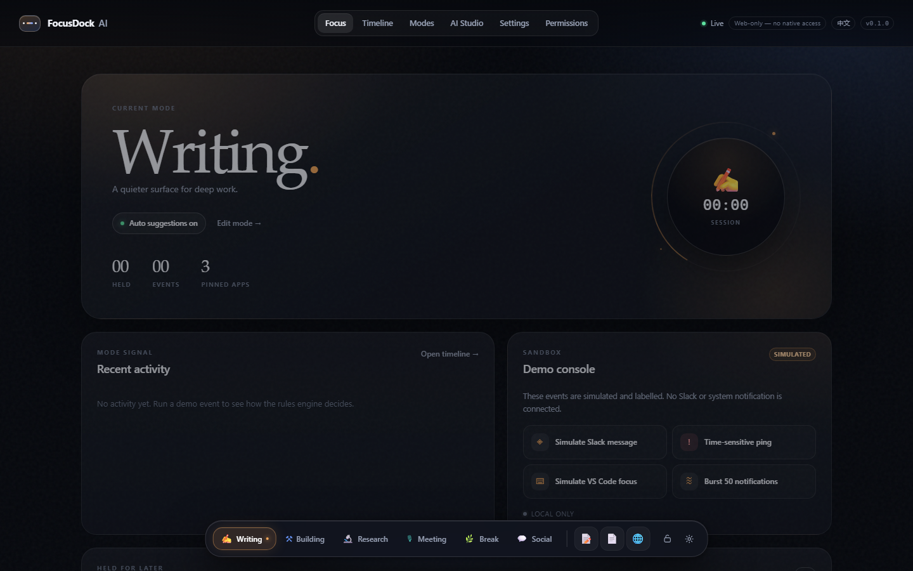

# FocusDock AI

**本地优先、AI 原生的专注 Dock：可定制工作模式，并提供可选的 macOS 浮层伴生程序。**

[English](README.md) · 简体中文



FocusDock AI 是一个真正可运行的本地 Web App：底部胶囊 Dock、可编辑模式、
离线确定性规则引擎、可审阅的 AI 模式编辑、带 30 秒切换冷静期的通知队列，以及
可追溯的审计时间线。所有数据保存在本机 SQLite；不需要账号、不上报遥测、不配置
API Key 也能完整使用。

> **本项目不拦截系统通知，也不替换 macOS 系统 Dock。** 公开 Apple API 不允许
> 一个应用拦截另一个应用的通知。界面会明确说明这一点，所有模拟事件都带
> `SIMULATED` 标记。

## 状态（v0.1.0）

| 领域 | 状态 | 证据 |
|---|---|---|
| Windows 11 本地 Web App | **通过** | 52 个服务端 + 4 个 Web + 13 个 Playwright 测试；截图在 `qa/evidence/` |
| 模式增删改、持久化、导入导出 | **通过** | API 与 E2E 测试 |
| 离线规则、停留/冷却、手动锁定 | **通过** | `server/test/rules.test.ts` |
| 通知延后 + 30 秒冷静期 + Go to Social | **通过** | API 与 E2E 测试 |
| AI 提案 → Diff → 确认 → 应用 → 回滚 | **通过**（规则引擎） | API 与 E2E 测试 |
| 可选 Ollama / OpenAI 兼容适配器 | **已实现，未实测** | 需要本地模型或真实端点 |
| macOS 浮动 Dock | **未验证** | 仅有 Swift 源码与 macOS CI 编译；开发机没有 Mac |
| 本机应用控制 / 启动 | **Web 未实现；Windows spike：允许列表启动** | 未发布的 Windows 伴生程序；Web dock 仍不启动应用 |
| 全局系统通知拦截 | **设计上不支持** | 公开 API 限制，界面中已说明 |
| 公开发布 | **已公开 v0.1.0** | [GitHub Release](https://github.com/AIMetaPhD/agentic-focus-dock/releases/tag/v0.1.0) |
| Profile README PR | **已合并** | [AIMetaPhD/AIMetaPhD#1](https://github.com/AIMetaPhD/AIMetaPhD/pull/1) |
| Muse 独立 QA | **未验证** | Muse VM/执行环境三次阻断；见 [`docs/QA_REPORT.md`](docs/QA_REPORT.md) |
| 独立子代理验证 | **通过（非 Muse）** | 56 个单元/集成 + 13 个 Playwright；[`qa/SUBAGENT_VERIFICATION_2026-10-30.md`](qa/SUBAGENT_VERIFICATION_2026-10-30.md) |

> **QA 说明：** 原计划要求 Muse 独立签核。Muse 三次都无法访问源码。随后由同机、
> 全新上下文的 Claude 子代理独立重跑测试与黑盒探针并通过。项目所有者接受其作为
> 补充证据，并于 2026-11-01 明确授权公开发布；Muse 门禁仍为**未验证**。这
> **不是** Muse 签核。

完整能力边界见 [`docs/CAPABILITIES.md`](docs/CAPABILITIES.md)。

## 快速开始

要求：**Node.js 22.5+**（推荐 24）与 npm。不需要 Python、数据库服务或 API Key。

```bash
git clone https://github.com/AIMetaPhD/agentic-focus-dock.git
cd agentic-focus-dock
npm install
npm start
```

`npm start` 会构建前端并在 `http://127.0.0.1:4317` 启动服务，然后打开浏览器。
端口被占用时会尝试 4318–4327；可用 `FOCUSDOCK_PORT` 指定端口，
`FOCUSDOCK_PORT_STRICT=1` 则直接在端口冲突时报错。Windows PowerShell 与
macOS 使用相同命令。

### 无网络、无 Key 的首次体验

应用会初始化六个模式（Writing、Building、Research、Meeting、Break、Social），
默认进入 Writing。**Demo console** 产生的事件都带 `SIMULATED` 标记：

1. Writing 模式下点击 **Simulate Slack message**。
2. Dock 上方出现卡片：*Maya Chen in #launch*、`SIMULATED`、*Held for social*。
3. **Stay** 保持 Writing；**Later** 关闭但不启动任何应用；**Go to Social**
   在 30 秒冷静期结束后才可点击，且必须由你确认。
4. 点击 **Simulate VS Code focus**；稳定停留 15 秒后建议切换到 Building。
   默认只建议、不自动切换；在两个模式中都关闭 “Suggest only” 才会自动切换。
5. 刷新页面：当前模式与历史仍然保留。

## 功能

- **Dock**：半透明胶囊、模式胶囊、固定应用图标（标签/书签）、手动锁定、待处理通知计数。
- **模式**：带版本的声明式 JSON；新增、编辑、删除、排序、导入导出、恢复默认、
  回滚到任意历史版本。
- **规则引擎**：应用白名单、关键词、稳定停留（默认 15 秒）、冷却、手动锁；
  没有模型也能工作。
- **通知队列**：时间敏感消息立即显示；非紧急社交通知在应用内暂存，并显示可取消的
  倒计时。
- **AI 工作室**：自然语言只生成受约束的 mode JSON Patch；展示 Diff，必须手动应用，
  可一键回滚。
- **时间线**：来源（`simulated`/`bridge`/`product`）、判定、理由、置信度、引擎、
  实际执行的动作。
- **设置**：AI 提供方、API Key、隐私保留期、排除应用、导入导出、清除事件、
  重置全部数据、中英文切换。
- **权限页**：真实的能力表、Bridge Token 轮换、绝不执行的行为清单。

## AI 配置

默认是纯规则模式，始终可用。两个可选提供方：

| 提供方 | 需要 | 数据边界 |
|---|---|---|
| Ollama | `http://127.0.0.1:11434` + 模型名 | 数据留在本机 |
| OpenAI 兼容端点 | Base URL、模型、API Key，且必须开启云端同意 | 发送你的提示词与模式摘要；只有你额外开启时才包含最近活动 |

API Key 保存在数据目录的 `secrets.json`（尽力设为 `0600`），**不写入 SQLite、
日志、导出文件或浏览器 localStorage**。详见 [`docs/PRIVACY.md`](docs/PRIVACY.md)。

所有提案都经过固定 schema 校验：只允许 `/modes/*` 路径与白名单字段，数值有界，
不允许 shell、AppleScript 或网络动作。模型失败会自动回退到确定性解析器。

## 本地数据

| 平台 | 目录 |
|---|---|
| Windows | `%LOCALAPPDATA%\FocusDock` |
| macOS | `~/Library/Application Support/FocusDock` |
| Linux | `~/.local/share/focusdock` |

可用 `FOCUSDOCK_DATA_DIR` 覆盖。目录包含 `focusdock.db`、可选的 `secrets.json`，
以及服务运行期间的 `runtime/bridge-token`。事件默认保留 7 天；可在设置中清除事件
或重置全部产品数据。

## 安全模型

- 只监听 **127.0.0.1**，拒绝 `0.0.0.0`。
- 校验 `Host`（防 DNS rebinding）与精确 `Origin`（写操作与 WebSocket）。
- 会话 Cookie 为 `HttpOnly; SameSite=Strict`；所有写操作还需要
  `X-FocusDock-CSRF` 双提交头；不开放宽松 CORS。
- macOS Bridge 使用独立的单次运行 Bearer Token，仅限 `/api/bridge/*`，保存在
  `0600` 文件，服务每次启动轮换。
- Token 不出现在任何 URL 或日志中。
- 内嵌 WebView 只能导航到本地 dock 页面与静态资源。

完整威胁模型与残余风险见 [`docs/THREAT_MODEL.md`](docs/THREAT_MODEL.md) 与
[`SECURITY.md`](SECURITY.md)。安全测试覆盖恶意 Host/Origin、缺少 CSRF、
跨源 WebSocket、Bridge Token 越权、超大请求体与模型输出注入。

## Windows 原生伴生程序（未发布）

`win-companion/` 是 v0.1.0 之后在 `main` 上的恢复性 spike，不属于 v0.1.0 Release。
它以 Windows 用户会话托盘程序运行，用 `SetWinEventHook` 观察真实前台应用，并只从
自己的 Start Menu 选择器启动已解析的 `.exe`。Web dock 仍不启动应用；它不读取或
静默系统通知。见 [`win-companion/README.md`](win-companion/README.md)。

## 可选 macOS 浮动 Dock

Swift 源码位于 [`mac-bridge/`](mac-bridge/README.md)：`NSPanel` + `WKWebView`
加载同一个 `/dock` 页面，并通过 `NSWorkspace` 观察前台应用。

```bash
cd mac-bridge
swift build -c release
./build-app.sh
open ".build/FocusDockBridge.app" --args --backend http://127.0.0.1:4317
```

**状态：未在真实 Mac 上验证。** 开发机是 Windows；CI 的 `macos-14` 只能证明
可以编译。宣告桌面体验完成前，必须在 Apple Silicon 上执行
`mac-bridge/README.md` 的七步检查并保存证据。

Bridge 不执行 `killall Dock`、不写入 `com.apple.dock`、不关闭 SIP、不读取其他
应用的通知数据库。

## 测试

```bash
npm run typecheck
npm run lint
npm test          # 52 个服务端 + 4 个 Web 单元/集成测试
npm run test:e2e  # 13 个 Playwright 测试
npm run verify    # 密钥扫描 + 以上全部 + 构建 + E2E
```

证据位置：

- API / 安全 / 规则测试：`server/test/`
- 端到端流程：`tests/e2e/`
- 截图：`qa/evidence/`
- Playwright 报告：`qa/evidence/playwright-report/`
- QA 报告：[`docs/QA_REPORT.md`](docs/QA_REPORT.md)

## 目录结构

```
server/        Fastify API、SQLite、规则、提案、安全
web/           React + Vite 仪表盘与 Dock
mac-bridge/    可选 Swift NSPanel/WKWebView 伴生程序
tests/e2e/     Playwright 场景
docs/          架构、API、能力、威胁模型、QA
scripts/       开发/预览/E2E 启动器、密钥扫描
qa/evidence/   截图与测试产物
```

## 已知限制

- 不拦截第三方通知，这是设计与平台限制。
- macOS 浮层源码完整，但未在真实硬件上验证。
- `node:sqlite` 仍被 Node 标记为实验特性；它被隔离在 `server/src/store.ts`，
  可替换为 `better-sqlite3`。
- 没有签名/公证的 `.app`，没有自动更新与安装器。
- 云端模型适配器已实现，但本环境没有真实端点可测。

## 许可证

MIT，见 [LICENSE](LICENSE)。第三方审计见
[`docs/THIRD_PARTY_AUDIT.md`](docs/THIRD_PARTY_AUDIT.md)。本仓库没有复制任何
GPL-3.0 或“保留所有权利”的代码。

灵感来自 Thariq 的 AI-native macOS Dock 实验
（<https://x.com/trq212/status/2115135857669881939>）。不存在隶属关系，也未声称
获得原作者源码。
